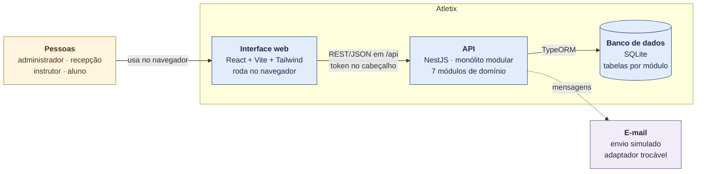
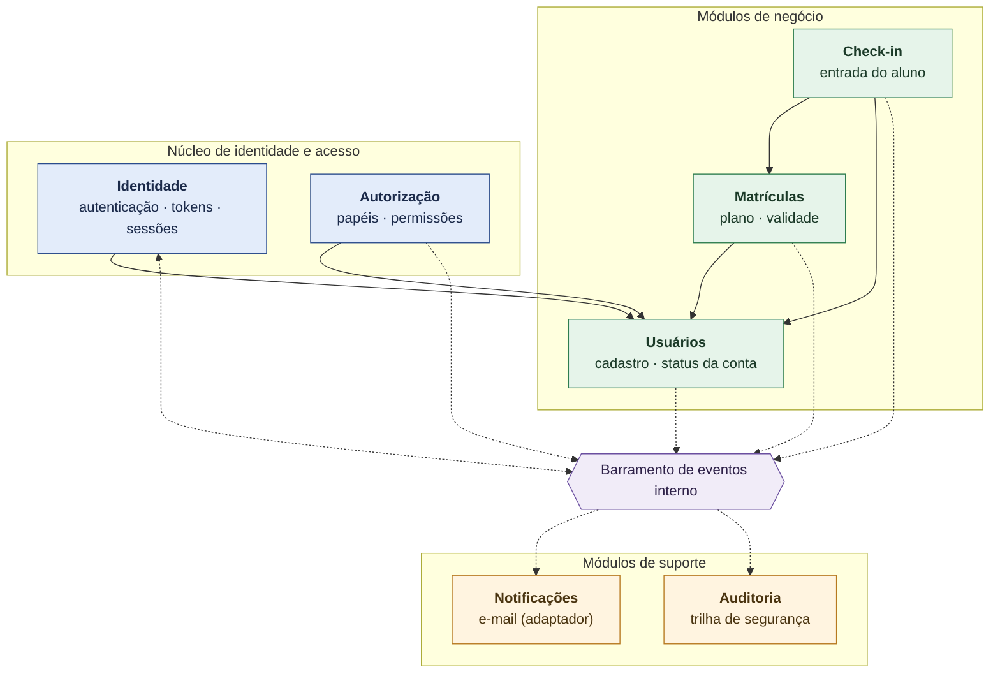

# 2. Estilo arquitetural e trade-offs — Atletix

> Decisão formal: [ADR-001 — Monólito modular particionado por domínio](adr/ADR-001-estilo-arquitetural.md)
> Stack e tipo de entrega: [ADR-002 — NestJS + TypeScript, aplicação funcional](adr/ADR-002-stack-e-entrega.md)

## 2.1 Ponto de partida: as duas leis da arquitetura

Richards e Ford abrem o livro com duas "leis" que guiaram esta escolha:

1. **Tudo em arquitetura de software é um trade-off.** Não existe estilo "melhor"; existe o **menos pior** para as características priorizadas.
2. **O porquê é mais importante do que o como.** Por isso cada decisão abaixo traz o motivo e o que estamos abrindo mão.

As características priorizadas (ver [Escopo §1.5](01-escopo-e-problema.md#15-características-arquiteturais)) foram **segurança**, **manutenibilidade/modularidade** e **evolutividade**. As restrições foram **2 semanas**, **3 pessoas** e **apresentação offline**.

## 2.2 Primeira decisão: particionamento técnico ou por domínio?

Antes de escolher o estilo, o livro recomenda decidir o **particionamento de nível superior**, ou seja, como o código é dividido no nível mais alto.

| | Particionamento técnico | Particionamento por domínio |
|---|---|---|
| Organização | `controllers/`, `services/`, `repositories/` | `identidade/`, `autorizacao/`, `checkin/` … |
| Uma mudança de negócio (ex.: adicionar MFA) | Atravessa **todas** as camadas | Fica concentrada **em um** módulo |
| Coesão | Por tipo técnico: junta coisas que não mudam juntas | **Funcional**: junta o que muda junto |
| Caminho para serviços | Difícil: o domínio está espalhado | Natural: cada módulo já é um candidato a serviço |

**Escolha: particionamento por domínio.** No Atletix, as mudanças esperadas são de negócio (nova forma de login, nova regra de check-in, novo papel). Com particionamento técnico, cada uma delas mexeria em pastas de camadas diferentes. Com particionamento por domínio, cada mudança fica num lugar só, que é exatamente a **alta coesão** pedida no critério A.

> As camadas técnicas continuam existindo, mas **dentro** de cada módulo (ver §2.5).

## 2.3 Estilos candidatos

A avaliação abaixo é **da equipe** (1 a 5, quanto maior melhor), inspirada nas tabelas de classificação de estilos do livro e aplicada ao contexto do Atletix.

| Característica | Camadas (técnico) | **Monólito modular** | Baseado em serviços | Microsserviços | Orientado a eventos |
|---|:-:|:-:|:-:|:-:|:-:|
| Simplicidade | 5 | **4** | 3 | 1 | 2 |
| Custo (5 = mais barato) | 5 | **5** | 3 | 1 | 2 |
| Modularidade | 1 | **4** | 4 | 5 | 4 |
| Evolutividade | 1 | **3** | 4 | 5 | 4 |
| Testabilidade | 2 | **4** | 4 | 4 | 2 |
| Segurança (facilidade de garantir) | 4 | **4** | 3 | 2 | 2 |
| Implantabilidade independente | 1 | **1** | 3 | 5 | 4 |
| Escalabilidade / elasticidade | 1 | **2** | 3 | 5 | 5 |
| Tolerância a falhas | 1 | **2** | 4 | 4 | 4 |

### Por que não cada alternativa

- **Arquitetura em camadas (pura, com particionamento técnico).** É simples e barata, mas tem **baixa modularidade**. Toda mudança de domínio atravessa as camadas, e o projeto tende ao antipadrão *architecture sinkhole* (camadas que só repassam chamadas). Ela atende pouco à nossa segunda e terceira prioridades.
- **Baseado em serviços.** É uma boa evolução futura, mas exige vários implantáveis e decisões sobre banco compartilhado. Para duas semanas e uma única academia, o custo extra não se paga **agora**.
- **Microsserviços.** São excelentes em escalabilidade e implantação independente, que **não** estão entre nossas prioridades. Trariam as **falácias da computação distribuída** (rede confiável, latência zero…) justamente para a autenticação: cada requisição de qualquer módulo dependeria de uma chamada de rede ao serviço de identidade. Também tornariam difícil revogar sessões de forma consistente e exigiriam infraestrutura (broker, gateway, observabilidade) incompatível com a equipe e o prazo.
- **Orientado a eventos (como estilo principal).** Autenticação é essencialmente **síncrona**: o usuário espera a resposta do login. Um fluxo totalmente assíncrono complicaria o rastreamento de erros e os testes. Ainda assim, **usamos eventos** onde eles fazem sentido (ver §2.4).

## 2.4 Decisão: monólito modular particionado por domínio + eventos internos

O sistema tem três partes que conversam em sequência: a interface web, a API e o banco de dados.



<p class="legenda">Figura 1 — Visão geral do Atletix: as partes do sistema e como elas se comunicam.</p>

Toda a lógica de negócio fica na API, organizada nos sete módulos da figura seguinte.



<p class="legenda">Figura 2 — Módulos da API. Seta contínua: chamada síncrona pelo contrato do módulo de destino. Seta tracejada: evento assíncrono, publicado no barramento por quem está acima dele e assinado por quem está abaixo. A Identidade também assina um evento de Usuários.</p>

> Duas dependências não aparecem na Figura 2 para não poluí-la. Todos os módulos usam o **núcleo compartilhado** (`compartilhado/`: erros de domínio, eventos, relógio e portas de segurança), que não depende de nenhum módulo. E a Autorização lê, no contrato de cada módulo, os **nomes das permissões** que ele declara, para montar a política de acesso.

- **Uma única unidade de implantação**, ou seja, um **quantum arquitetural** só: simples de rodar, testar e apresentar.
- **Módulos por domínio** com fronteiras explícitas. Cada módulo NestJS **exporta apenas o seu contrato público** (interfaces e DTOs) e mantém o resto privado.
- **Comunicação síncrona por contrato** quando quem chama precisa da resposta. Exemplo: o Check-in pergunta à Matrículas se a matrícula está ativa.
- **Comunicação assíncrona por eventos internos** para efeitos colaterais. Exemplo: `SenhaRedefinida` é tratado por Notificações e Auditoria, e `UsuarioDesativado` faz a Identidade revogar as sessões. Assim, quem publica o evento não conhece quem o consome.
- **Cada módulo é dono das suas tabelas.** Nenhum módulo lê ou grava as tabelas de outro.

## 2.5 Camadas dentro de cada módulo

Dentro de cada módulo usamos camadas, com as dependências apontando para o domínio:

```
src/modulos/<modulo>/
├── api/              → entradas do módulo: controllers HTTP, DTOs e ouvintes de eventos
├── aplicacao/        → casos de uso (orquestram o domínio)
├── dominio/          → entidades, regras de negócio, eventos de domínio
├── infraestrutura/   → repositórios (TypeORM), adaptadores (e-mail, hash, JWT)
├── contratos/        → interfaces e tipos que OUTROS módulos podem usar
└── <modulo>.module.ts
```

Regra: `api → aplicacao → dominio ← infraestrutura`. O domínio não conhece framework, banco nem HTTP. Isso responde a pergunta "**por que usar camadas?**": separar *o que* o sistema faz (regras) de *como* ele é exposto (HTTP) e de *onde* os dados ficam (banco), para que cada um mude sem afetar os outros.

## 2.6 Trade-offs assumidos

| Ganhamos | Abrimos mão de |
|---|---|
| Simplicidade de implantação, depuração e apresentação (um processo) | **Implantação independente**: qualquer mudança gera nova versão do sistema todo |
| Chamadas entre módulos em memória (rápidas, sem falhas de rede) | **Escalabilidade independente**: não dá para escalar só a Identidade no pico de check-in |
| Transações e consistência simples (ex.: revogar sessões ao desativar conta) | **Isolamento de falhas**: um erro grave derruba todos os módulos |
| Fronteiras de domínio claras = alta coesão e baixo acoplamento | **Disciplina constante**: no monólito é fácil "furar" a fronteira com um `import` indevido. Mitigamos com uma função de aptidão (§2.7) |
| Custo baixo, compatível com 2 semanas e 3 pessoas | Uso de tecnologias distribuídas que "chamariam atenção" mas não atendem às prioridades |

## 2.7 Como garantir a decisão no código (funções de aptidão)

Richards e Ford defendem **funções de aptidão** (*fitness functions*), que são verificações automáticas de que a arquitetura continua como foi decidida. No Atletix:

1. **Regras de dependência** (arquivo `backend/.dependency-cruiser.cjs`, executadas com `npm run arquitetura`):
    - um módulo só importa de outro módulo pela pasta `contratos/`;
    - o domínio não importa `@nestjs/*`, `typeorm` nem as camadas `api/`, `aplicacao/` e `infraestrutura/`;
    - os casos de uso não conhecem `api/` nem `infraestrutura/`, e a `api/` não acessa o banco;
    - o contrato de um módulo não expõe as camadas internas dele;
    - o núcleo compartilhado não depende de nenhum módulo;
    - não há ciclos de importação entre arquivos, e as chamadas síncronas entre módulos formam um grafo sem ciclos (a seção 5.3 detalha o alcance desta regra).
2. **Testes de ponta a ponta dos cenários de qualidade** (`npm run test:e2e`): rotas protegidas respondem **401/403** sem token ou com papel insuficiente, a conta desativada perde o acesso na requisição seguinte e a troca de papel vale imediatamente.

Essas verificações também servem como **evidência** da consistência entre documentação e implementação (critério C.3).

## 2.8 Caminho de evolução

O monólito modular foi escolhido também porque **não fecha portas**:

| Necessidade futura | O que muda |
|---|---|
| Escalar a autenticação separadamente | Extrair o módulo **Identidade** como serviço (arquitetura baseada em serviços). Os contratos viram APIs HTTP e o barramento interno vira um broker (ex.: RabbitMQ). Os outros módulos não mudam, só a implementação do contrato |
| MFA / login social | Novas estratégias **dentro** de Identidade; os demais módulos continuam recebendo o mesmo "usuário autenticado" |
| Várias unidades | Novo conceito `Unidade` em Usuários/Matrículas; a Autorização ganha escopo por unidade |
| Aplicativo móvel | Consome a mesma API REST; os tokens já são independentes de cookie/navegador |
