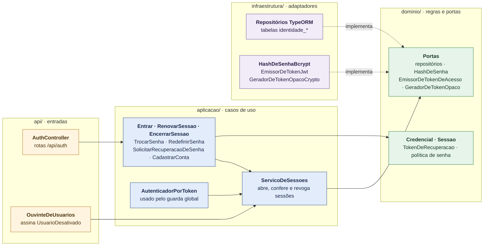

# 3. Módulos e responsabilidades — Atletix

Esta seção apresenta os módulos da API, o que cada um faz e como todos são organizados por dentro.

> **Como ler os caminhos de arquivo.** Nas seções 3 a 7 e nos ADRs, um caminho que começa pelo nome de um módulo, como `identidade/dominio/credencial.ts`, fica em `backend/src/modulos/`. Os que começam por `compartilhado/` ficam em `backend/src/`. Os demais aparecem completos.

## 3.1 O que cada módulo faz

A API reúne **sete módulos** na mesma aplicação. Cada um tem uma responsabilidade e um motivo próprio para mudar.

| Módulo | Responsabilidade | Por que é um módulo separado |
|---|---|---|
| `identidade` | Confirma quem é o usuário: senha, tokens e sessões. | Regras de senha, bloqueio e sessão mudam por motivos de segurança, não de negócio. |
| `autorizacao` | Define o que cada um pode fazer: papéis e permissões. | A política de acesso muda sem que o login mude. |
| `usuarios` | Guarda o cadastro da pessoa e se a conta está ativa. | Nome, e-mail e status são usados por vários fluxos e precisam de uma fonte única. |
| `matriculas` | Registra o plano do aluno e calcula até quando ele vale. | Duração e renovação de planos são regras do vínculo com a academia. |
| `checkin` | Libera e registra a entrada do aluno. | A regra de entrada pode mudar sem tocar em cadastro ou em planos. |
| `notificacoes` | Transforma eventos em e-mails e cuida do envio. | O texto das mensagens e a forma de envio mudam em ritmo próprio. |
| `auditoria` | Guarda a trilha dos eventos de segurança. | O que é registrado e como é consultado evolui sem afetar quem gera os eventos. |

A montagem de cada módulo está no arquivo `<módulo>.module.ts` da sua pasta, por exemplo `identidade/identidade.module.ts`. A raiz que junta os sete, o guarda de segurança, o barramento de eventos e o banco é `backend/src/app.module.ts`.

## 3.2 Como cada módulo é organizado por dentro

Os sete módulos têm as mesmas cinco pastas.

| Pasta | Papel | Exemplo |
|---|---|---|
| `api/` | Entradas do módulo: rotas HTTP e ouvintes de eventos. | `identidade/api/auth.controller.ts` |
| `aplicacao/` | Casos de uso, que coordenam os passos de cada operação. | `checkin/aplicacao/registrar-checkin.ts` |
| `dominio/` | Entidades, regras e portas, sem depender de framework. | `matriculas/dominio/matricula.ts` |
| `infraestrutura/` | Banco de dados e integrações. | `notificacoes/infraestrutura/adaptadores.ts` |
| `contratos/` | A única parte que outros módulos podem usar: interfaces, eventos e nomes de permissões. | `matriculas/contratos/consulta-de-matriculas.ts` |

O que é comum a todos fica no núcleo compartilhado: relógio, erros de domínio, publicação de eventos e portas de segurança. Ver `compartilhado/nucleo.module.ts`.

## 3.3 Um exemplo de fronteira: criar uma conta

Criar uma conta envolve três responsabilidades que poderiam ter ficado na mesma classe. No Atletix, cada uma tem um dono:

1. **Identidade** valida a senha e guarda a credencial. Ver `identidade/aplicacao/cadastrar-conta.ts`.
2. **Usuários** guarda o nome e o e-mail. Ver `usuarios/aplicacao/diretorio-de-usuarios-local.ts`.
3. **Autorização** dá o papel padrão a quem ainda não recebeu um. Ver `autorizacao/aplicacao/consultar-acesso.ts`.

Senha, dados cadastrais e papel participam do mesmo fluxo, mas cada um pode mudar sem mexer nos outros dois.

## 3.4 Por dentro do módulo Identidade

O módulo central do trabalho mostra como as cinco pastas se encaixam. As entradas chamam os casos de uso, os casos de uso usam as regras e as portas do domínio, e a infraestrutura implementa as portas.

Figura 4 — Componentes do módulo Identidade. Seta contínua: usa. Seta tracejada: implementa a porta definida no domínio.

Para fora do módulo, a Identidade usa apenas o contrato `DiretorioDeUsuarios`, publica os seus eventos no barramento e oferece a porta `Autenticador` ao guarda global. Ver `identidade/identidade.module.ts`, onde cada porta é ligada ao seu adaptador.
