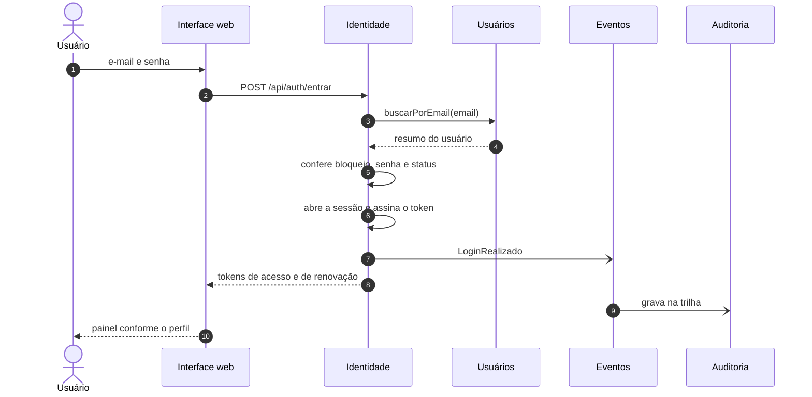
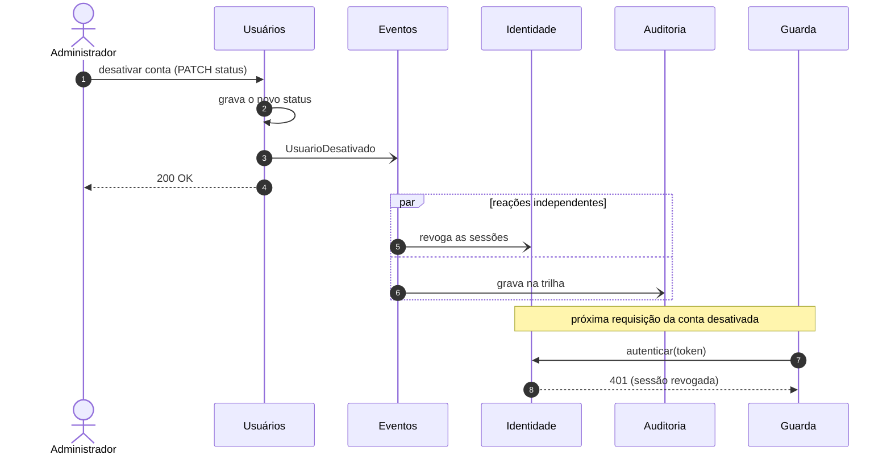

# 5. Análise de acoplamento — Atletix

## 5.1 Quem depende de quem

A linha é o módulo que **usa** o contrato, e a coluna é seu **dono**. Em eventos, a seta da dependência vai do assinante ao produtor, pois o assinante importa a classe do evento. A circulação do evento em execução segue no sentido oposto.

- **S** — chamada em processo cujo resultado é esperado pelo consumidor. Os `imports` de montagem NestJS dessas chamadas entram na mesma relação.
- **E** — assinatura de evento declarado no contrato do produtor.
- **P** — leitura de nomes de permissões para montar a política de acesso.

**Ca** (aferente) conta os módulos que dependem de um módulo, pela coluna. **Ce** (eferente) conta os módulos dos quais ele depende, pela linha. Cada par conta uma vez, mesmo com dois tipos de vínculo. A contagem considera os sete módulos de domínio e deixa a raiz de composição, o núcleo compartilhado, os clientes HTTP e as bibliotecas fora desse recorte.

| Consumidor | Id | Az | Us | Mt | Ck | Nt | Au | Ca | Ce |
|---|:---:|:---:|:---:|:---:|:---:|:---:|:---:|---:|---:|
| Identidade (Id) | — | — | S, E | — | — | — | — | 2 | 1 |
| Autorização (Az) | — | — | S, P | P | P | P | P | 1 | 5 |
| Usuários (Us) | — | — | — | — | — | — | — | 5 | 0 |
| Matrículas (Mt) | — | — | S | — | — | — | — | 3 | 1 |
| Check-in (Ck) | — | — | S | S | — | — | — | 2 | 2 |
| Notificações (Nt) | E | — | — | — | — | — | — | 1 | 1 |
| Auditoria (Au) | E | E | E | E | E | — | — | 1 | 5 |

| Relação | Evidência das células preenchidas |
|---|---|
| Id → Us (S, E) | `backend/src/modulos/identidade/aplicacao/autenticador-por-token.ts` consulta a conta e `backend/src/modulos/identidade/api/ouvinte-de-usuarios.ts` assina `UsuarioDesativado`. |
| Az → Us (S) | `backend/src/modulos/autorizacao/aplicacao/alterar-papel.ts` verifica usuários pelo diretório. |
| Az → Us, Mt, Ck, Nt, Au (P) | `backend/src/modulos/autorizacao/dominio/politica-de-acesso.ts` importa as constantes `PermissoesDe*` dos cinco contratos. |
| Mt → Us (S) | `backend/src/modulos/matriculas/aplicacao/registrar-matricula.ts` consulta a existência e o status da conta. |
| Ck → Us, Mt (S) | `backend/src/modulos/checkin/aplicacao/registrar-checkin.ts` aguarda o diretório de usuários e a consulta de matrículas. |
| Nt → Id (E) | `backend/src/modulos/notificacoes/api/ouvinte-de-identidade.ts` assina quatro eventos de Identidade. |
| Au → Id, Az, Us, Mt, Ck (E) | `backend/src/modulos/auditoria/api/ouvinte-de-eventos.ts` assina os eventos dos cinco produtores. |

**Usuários** tem a maior entrada de dependências. Mudar o diretório, os eventos ou os nomes de permissões pode afetar consumidores diferentes. **Autorização** e **Auditoria** têm a maior saída, por centralizarem a política de permissões e a trilha de eventos, respectivamente. O `Ce = 5` de Auditoria indica alcance sobre contratos de eventos, sem cinco serviços de execução a invocar.

## 5.2 Como as fronteiras reduzem o impacto das mudanças

**Consulta síncrona por contrato.** O Check-in espera os resultados de `buscarPorId` e `situacaoDoAluno` antes de decidir a entrada. São chamadas locais que devolvem `Promise`. O Check-in depende da resposta para prosseguir e pode usar a mesma interface se Matrículas mudar a forma de calcular a vigência. Os dublês no teste demonstram a substituição. Ver `backend/src/modulos/checkin/aplicacao/registrar-checkin.spec.ts`, `backend/src/modulos/usuarios/contratos/diretorio-de-usuarios.ts` e `backend/src/modulos/matriculas/contratos/consulta-de-matriculas.ts`.

**Injeção de dependências.** O módulo Matrículas exporta o token `CONSULTA_DE_MATRICULAS`, vinculado à implementação `ConsultarSituacao`. A montagem de Check-in importa `MatriculasModule`. O guarda global combina as portas `Autenticador` e `Autorizador` com implementações fornecidas por Identidade e Autorização. Se o contrato da porta for preservado, uma troca do mecanismo de validação do token fica no adaptador e na montagem de Identidade. Ver `backend/src/modulos/matriculas/matriculas.module.ts`, `backend/src/modulos/checkin/checkin.module.ts`, `backend/src/compartilhado/seguranca/portas.ts`, `backend/src/app.module.ts` e `backend/src/modulos/identidade/infraestrutura/adaptadores.ts`.

**Permissões declaradas na fronteira.** O controller informa a permissão pelo decorador. Autorização decide quais papéis a possuem. Adicionar uma permissão envolve seu contrato, a rota e a política. Alterar os papéis que recebem uma permissão existente concentra a mudança na política. Ver `backend/src/modulos/checkin/api/checkin.controller.ts`, `backend/src/modulos/checkin/contratos/permissoes.ts` e `backend/src/modulos/autorizacao/dominio/politica-de-acesso.ts`.

**Eventos internos.** Usuários publica `UsuarioDesativado` após salvar o status, e a Identidade reage revogando as sessões. A próxima requisição protegida já consulta o status da conta. Para recuperação de senha, Notificações usa o destinatário presente no evento e Auditoria registra apenas os campos selecionados pelo ouvinte. Um novo ouvinte ou uma mudança no e-mail pode ser implementado mantendo o produtor e o contrato do evento. Ver `backend/src/modulos/usuarios/aplicacao/alterar-status-do-usuario.ts`, `backend/src/modulos/identidade/api/ouvinte-de-usuarios.ts`, `backend/src/modulos/identidade/aplicacao/autenticador-por-token.ts`, `backend/src/modulos/notificacoes/api/ouvinte-de-identidade.ts` e `backend/src/modulos/auditoria/api/ouvinte-de-eventos.ts`.

O publicador chama `emit` no mesmo processo. O despacho inicia os ouvintes durante a emissão e o produtor **segue sem aguardar** o trabalho assíncrono deles. A entrega é em memória, sem fila durável nem garantia de conclusão conjunta entre a gravação do produtor e as reações. Os ouvintes dependem do nome e do formato do evento. Ver `backend/src/compartilhado/eventos/publicador-em-memoria.ts` e `backend/src/app.module.ts`.

**Persistência por módulo.** Todos usam o SQLite configurado na raiz, com modelos e tabelas próprios. A lista de check-ins consulta o diretório para resolver o nome do aluno, sem fazer `JOIN` com a tabela de Usuários. Essa fronteira permite mudar colunas internas de Usuários sem alterar a consulta do Check-in quando o resumo público é preservado. Ver `backend/src/app.module.ts`, `backend/src/modulos/checkin/aplicacao/consultar-checkins.ts`, `backend/src/modulos/checkin/infraestrutura/repositorio-de-checkins-typeorm.ts` e `backend/src/modulos/usuarios/infraestrutura/usuario.modelo.ts`.

**REST na borda.** O navegador usa a API sob `/api`, com DTOs de entrada validados e documentação Swagger em `/api/docs`. Assim, o cliente depende do contrato HTTP e mudanças internas de persistência podem preservar esse contrato. A versão configurada é a do documento Swagger. As rotas e os DTOs desse fluxo não têm versionamento. Ver `frontend/src/compartilhado/api.ts`, `backend/src/app.module.ts`, `backend/src/main.ts` e `backend/src/modulos/identidade/api/dto.ts`.

## 5.3 O alcance da verificação de ciclos

O grafo de **chamadas síncronas entre módulos** é acíclico. Com todos os contratos da matriz, aparece um ciclo no nível de módulos, `Autorização → Auditoria → Autorização`. A política importa a permissão de consulta da Auditoria, e o ouvinte importa o evento `PapelAlterado`. Essas arestas passam por **arquivos distintos e sem ciclo de imports**. A regra `sem-dependencias-ciclicas` do `dependency-cruiser` verifica o grafo de arquivos e as regras de fronteira permitem o uso de contratos e a montagem por `*.module.ts`. Ver `backend/.dependency-cruiser.cjs`, `backend/src/modulos/autorizacao/dominio/politica-de-acesso.ts`, `backend/src/modulos/auditoria/contratos/permissoes.ts`, `backend/src/modulos/auditoria/api/ouvinte-de-eventos.ts` e `backend/src/modulos/autorizacao/contratos/eventos.ts`.

## 5.4 Dois fluxos passo a passo

Os diagramas a seguir mostram os dois tipos de comunicação em fluxos reais de autenticação. Seta cheia é chamada síncrona, com quem chama esperando a resposta. Seta aberta é evento, publicado sem esperar por quem assina.

Figura 3 — Login. A Identidade consulta Usuários pelo contrato e avisa o restante do sistema por evento.

No login, a única chamada entre módulos é a consulta ao diretório de Usuários. A Auditoria recebe o evento depois que a resposta já foi enviada, então uma falha na gravação da trilha não impede o login. Ver `backend/src/modulos/identidade/aplicacao/entrar.ts`.

Figura 4 — Desativação de conta. Usuários não conhece a Identidade: publica o evento, e cada assinante reage por conta própria.

Na desativação, Usuários não chama ninguém. A Identidade decide sozinha encerrar as sessões, e a requisição seguinte do usuário desativado é recusada pelo guarda. Para acrescentar uma nova reação, como avisar o usuário por e-mail, basta um novo assinante; o módulo Usuários não muda. Ver `backend/src/modulos/usuarios/aplicacao/alterar-status-do-usuario.ts` e `backend/src/modulos/identidade/api/ouvinte-de-usuarios.ts`.
