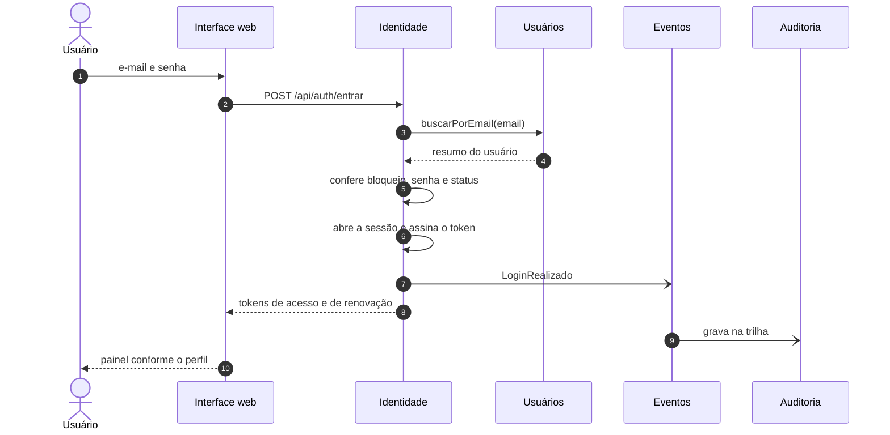
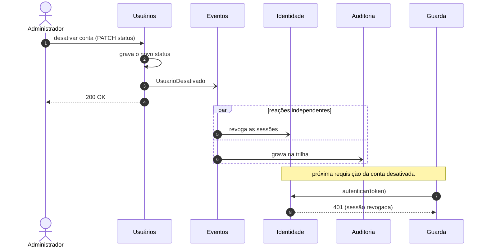
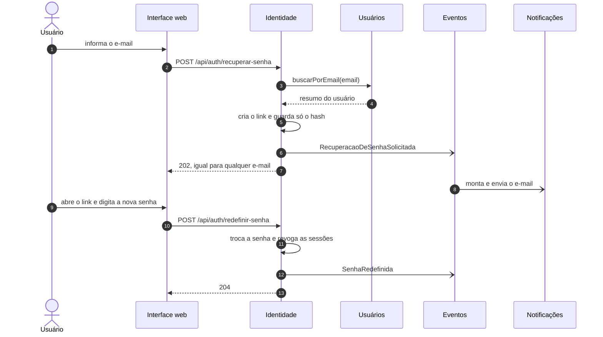

# 5. Análise de acoplamento — Atletix

## 5.1 Quem depende de quem

Cada linha da matriz mostra de quais módulos aquele módulo depende. A dependência é sempre do **contrato** do outro módulo, nunca do seu interior. Há três tipos de vínculo:

- **S** — chamada síncrona: quem chama espera a resposta.
- **E** — evento: quem assina usa a classe do evento, publicada no contrato de quem o produz.
- **P** — permissões: a Autorização lê os nomes das permissões de cada módulo para montar a política.

| Módulo | Id | Az | Us | Mt | Ck | Nt | Au | Ca | Ce |
|---|:---:|:---:|:---:|:---:|:---:|:---:|:---:|---:|---:|
| Identidade (Id) | — | — | S, E | — | — | — | — | 2 | 1 |
| Autorização (Az) | — | — | S, P | P | P | P | P | 1 | 5 |
| Usuários (Us) | — | — | — | — | — | — | — | 5 | 0 |
| Matrículas (Mt) | — | — | S | — | — | — | — | 3 | 1 |
| Check-in (Ck) | — | — | S | S | — | — | — | 2 | 2 |
| Notificações (Nt) | E | — | — | — | — | — | — | 1 | 1 |
| Auditoria (Au) | E | E | E | E | E | — | — | 1 | 5 |

**Ce** (acoplamento eferente) é de quantos módulos ele depende, contado na linha. **Ca** (acoplamento aferente) é quantos módulos dependem dele, contado na coluna.

O que a matriz mostra:

- **Usuários é a base.** Cinco módulos dependem dele (Ca = 5) e ele não depende de ninguém (Ce = 0). Por isso o seu contrato deve mudar pouco.
- **Autorização e Auditoria têm o maior Ce (5), mas é um acoplamento fraco.** Elas conhecem apenas nomes de permissões e classes de eventos. Nenhuma das duas chama serviços dos outros módulos.
- **As únicas chamadas síncronas vão em direção a Usuários e a Matrículas.** Não existe chamada síncrona de volta.

| Dependência | Onde ver |
|---|---|
| Id → Us (S, E) | `identidade/aplicacao/autenticador-por-token.ts` consulta a conta; `identidade/api/ouvinte-de-usuarios.ts` assina `UsuarioDesativado` |
| Az → Us (S) | `autorizacao/aplicacao/alterar-papel.ts` |
| Az → demais (P) | `autorizacao/dominio/politica-de-acesso.ts` |
| Mt → Us (S) | `matriculas/aplicacao/registrar-matricula.ts` |
| Ck → Us, Mt (S) | `checkin/aplicacao/registrar-checkin.ts` |
| Nt → Id (E) | `notificacoes/api/ouvinte-de-identidade.ts`, que assina quatro eventos |
| Au → cinco módulos (E) | `auditoria/api/ouvinte-de-eventos.ts` |

## 5.2 Como os módulos se comunicam

Seis estratégias mantêm o acoplamento baixo. Cada uma limita o alcance de um tipo de mudança.

| Nº | Estratégia | Como aparece no Atletix | O que ela protege |
|:---:|---|---|---|
| 1 | **Contrato síncrono** | O Check-in pergunta a `DiretorioDeUsuarios` e a `ConsultaDeMatriculas` e espera a resposta | Matrículas pode mudar o cálculo da validade sem o Check-in mudar |
| 2 | **Injeção de dependências** | Cada caso de uso recebe os contratos pelo construtor. O guarda global recebe as portas `Autenticador` e `Autorizador` | Trocar a implementação não altera quem a usa. Nos testes, entram dublês |
| 3 | **Permissões no contrato** | A rota declara a permissão que exige. A Autorização decide quais papéis a possuem | Mudar quem pode fazer o quê altera um único arquivo |
| 4 | **Eventos internos** | Quem publica não conhece quem assina. `UsuarioDesativado` faz a Identidade encerrar as sessões | Uma nova reação é um novo assinante; o produtor não muda |
| 5 | **Tabelas por módulo** | A lista de check-ins busca o nome do aluno pelo contrato de Usuários, sem `JOIN` entre tabelas | Usuários pode mudar as suas colunas sem quebrar o Check-in |
| 6 | **API REST na borda** | A interface web conhece apenas as rotas em `/api`, documentadas no Swagger | O interior da API muda sem a interface mudar |

Onde ver cada estratégia:

1. `usuarios/contratos/diretorio-de-usuarios.ts` e `matriculas/contratos/consulta-de-matriculas.ts`.
2. `compartilhado/seguranca/portas.ts` e o teste com dublês `checkin/aplicacao/registrar-checkin.spec.ts`.
3. `checkin/contratos/permissoes.ts` e `autorizacao/dominio/politica-de-acesso.ts`.
4. `usuarios/aplicacao/alterar-status-do-usuario.ts` e `identidade/api/ouvinte-de-usuarios.ts`.
5. `checkin/aplicacao/consultar-checkins.ts`.
6. `frontend/src/compartilhado/api.ts` e `backend/src/main.ts`.

**Limites assumidos.** Os eventos são entregues em memória, no mesmo processo, sem fila de mensagens. Quem publica não espera pelos assinantes, e uma falha em um assinante não afeta os outros, o que é verificado no teste `compartilhado/eventos/publicador-em-memoria.spec.ts`. Em compensação, se o processo cair entre a gravação e a reação, a reação se perde. Isso é aceitável para notificações e auditoria neste contexto; uma fila de mensagens resolveria e exigiria trocar apenas o publicador. As rotas REST também não têm versionamento.

## 5.3 Dependências cíclicas

- **Entre arquivos:** não há ciclos de importação. A regra `sem-dependencias-ciclicas` de `backend/.dependency-cruiser.cjs` falha o build se aparecer um.
- **Entre chamadas síncronas de módulos:** não há ciclos.
- **Somando todos os tipos de vínculo:** existe um ciclo entre Autorização e Auditoria. A Autorização lê o nome da permissão da Auditoria (P), e a Auditoria assina o evento `PapelAlterado` da Autorização (E). São dois arquivos de contrato diferentes, e nenhum dos dois módulos chama o outro. Ver `auditoria/contratos/permissoes.ts` e `autorizacao/contratos/eventos.ts`.

## 5.4 Três fluxos passo a passo

Os diagramas mostram os dois tipos de comunicação em fluxos reais de autenticação. Seta cheia é chamada síncrona, com quem chama esperando a resposta. Seta aberta é evento, publicado sem esperar por quem assina.

Figura 5 — Login. A Identidade consulta Usuários pelo contrato e avisa o restante do sistema por evento.

No login, a única chamada entre módulos é a consulta ao diretório de Usuários. A Auditoria recebe o evento sem que a Identidade espere por ela, então uma falha na gravação da trilha não impede o login. Ver `identidade/aplicacao/entrar.ts`.

Figura 6 — Desativação de conta. Usuários não conhece a Identidade: publica o evento, e cada assinante reage por conta própria.

Na desativação, Usuários não chama ninguém. A Identidade decide sozinha encerrar as sessões, e a requisição seguinte da conta desativada é recusada pelo guarda. Para acrescentar uma reação, como avisar o usuário por e-mail, basta um novo assinante. Ver `usuarios/aplicacao/alterar-status-do-usuario.ts` e `identidade/api/ouvinte-de-usuarios.ts`.

Figura 7 — Recuperação de senha. A Identidade cria o link, e Notificações decide como entregá-lo.

Na recuperação de senha, a Identidade não sabe como o e-mail é enviado: o evento já leva o nome, o e-mail e o link. A resposta é igual para qualquer e-mail, o que impede descobrir quais contas existem. Ver `identidade/aplicacao/solicitar-recuperacao-de-senha.ts`.
