# 8. A aplicação em funcionamento — Atletix

## 8.1 Como executar

A aplicação tem duas partes: a API (`backend/`) e a interface web (`frontend/`). O passo a passo completo e as contas de demonstração estão no `README.md` do repositório. Em resumo:

```
cd backend   &&  npm install  &&  npm run semente  &&  npm run start
cd frontend  &&  npm install  &&  npm run dev
```

A interface abre em `http://localhost:5173` e a documentação da API em `http://localhost:3000/api/docs`. O comando `npm run verificar`, na pasta `backend`, executa as regras de arquitetura e todos os testes.

## 8.2 Telas e o que cada uma evidencia

As telas abaixo foram capturadas da aplicação rodando com os dados de demonstração. A interface não contém regras de negócio: ela mostra o que a API responde. Por isso cada tela é também uma evidência do comportamento dos módulos.

### Autenticação

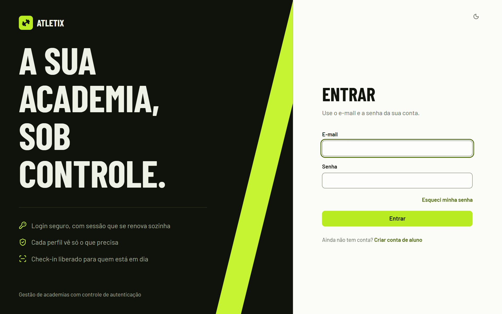

<p class="legenda">Figura 8 — Tela de login, com acesso ao cadastro e à recuperação de senha.</p>

O login é atendido pelo módulo **Identidade** (RF01). A resposta para senha errada e para e-mail inexistente é a mesma, e cinco senhas erradas bloqueiam a conta por 15 minutos (RF06).

### O mesmo sistema para perfis diferentes

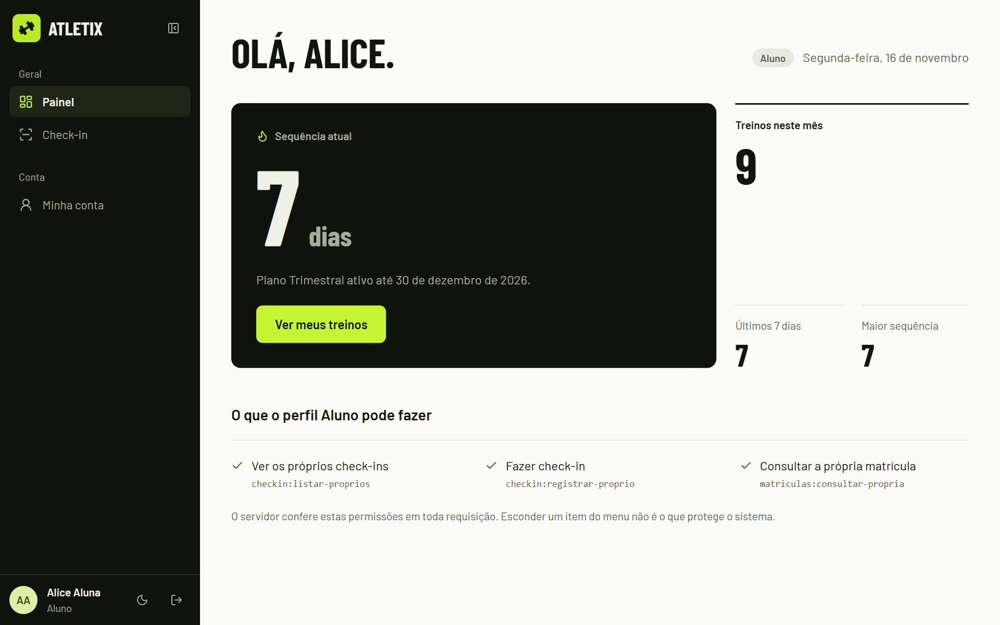

<p class="legenda">Figura 9 — Painel de um aluno: três permissões e menu reduzido.</p>

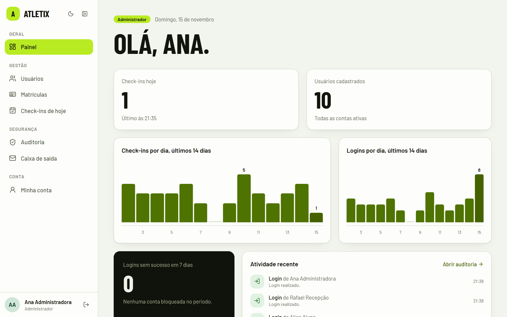

<p class="legenda">Figura 10 — Painel do administrador: nove permissões e menu completo.</p>

As duas telas são a mesma página. O menu e os blocos mudam conforme as permissões que a **Autorização** devolve para o usuário (RF07). O quadro "O que o perfil pode fazer" mostra cada permissão em linguagem comum e, logo abaixo, o nome exato declarado no contrato do módulo.

Os gráficos do administrador não usam nenhuma rota própria: os números são contados na interface a partir da trilha de auditoria, que a API já entrega. A sequência de treinos do aluno sai dos check-ins dele, pelo mesmo princípio.

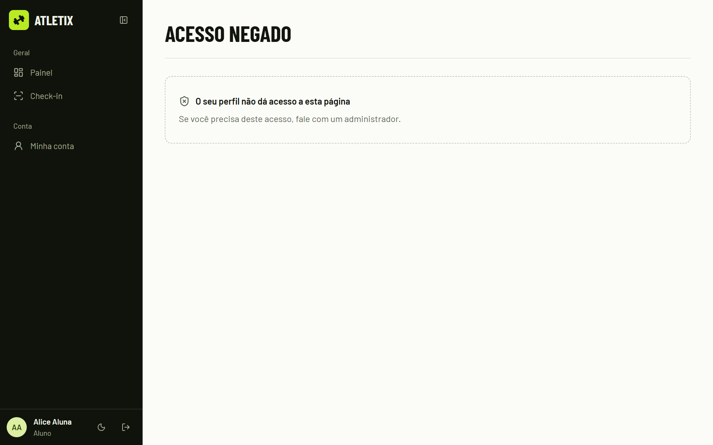

<p class="legenda">Figura 11 — Aluno tentando abrir a página de usuários pelo endereço.</p>

Esconder um item do menu não é segurança. Quando o aluno digita o endereço de uma página administrativa, a interface mostra o aviso acima e, se ele chamar a API diretamente, o guarda de segurança responde **403** (RF09). Esse comportamento é verificado nos testes de ponta a ponta para os quatro perfis.

### Regras de negócio que dependem da identidade

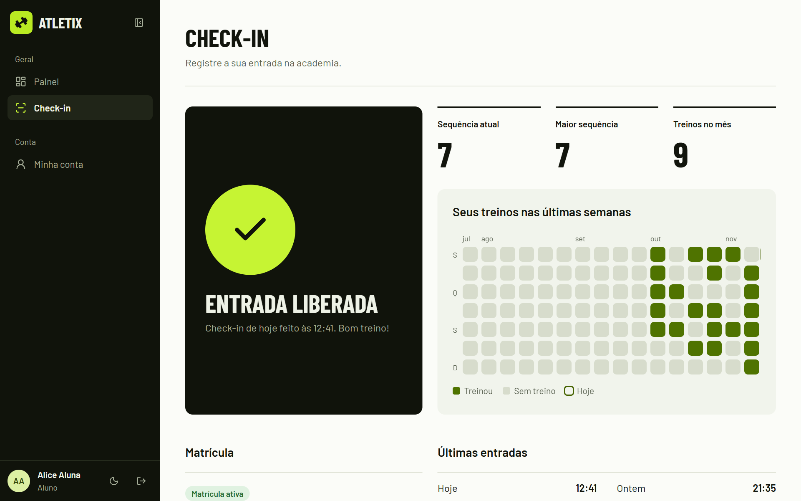

<p class="legenda">Figura 12 — Check-in liberado para uma aluna com conta e matrícula ativas.</p>

O módulo **Check-in** só libera a entrada depois de perguntar ao contrato de **Usuários** se a conta está ativa e ao contrato de **Matrículas** se a matrícula está em dia (RF14). Uma segunda tentativa no mesmo dia é recusada.

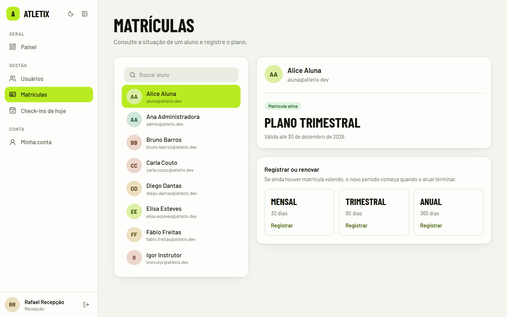

<p class="legenda">Figura 13 — Recepção consultando e renovando a matrícula de uma aluna.</p>

A lista de pessoas vem de **Usuários** e a situação da matrícula vem de **Matrículas** (RF12 e RF13). A tela junta as duas respostas; no servidor, nenhum dos dois módulos lê a tabela do outro.

### Administração e rastreabilidade

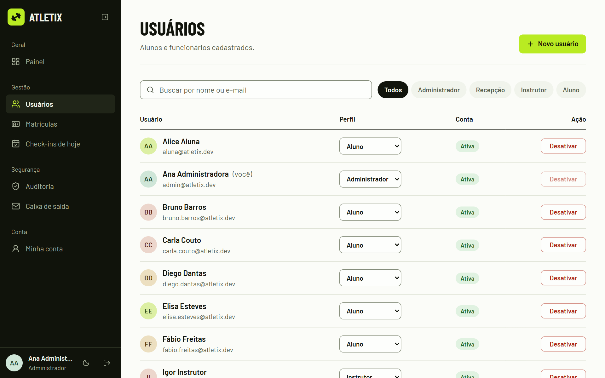

<p class="legenda">Figura 14 — Administrador alterando perfis e desativando contas.</p>

Cada controle desta tela fala com um módulo diferente: o seletor de perfil chama a **Autorização** (RF08) e o botão de desativar chama **Usuários** (RF11). Quando uma conta é desativada, a **Identidade** reage ao evento e encerra as sessões dela.

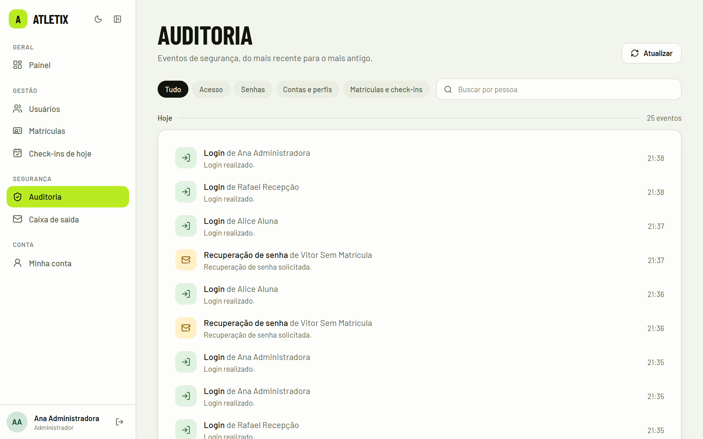

<p class="legenda">Figura 15 — Trilha de auditoria com os eventos de segurança.</p>

Todas as linhas desta tela foram gravadas a partir de eventos (RF17 e RF18). Nenhum módulo chama a **Auditoria**: ela apenas assina o que os outros publicam.

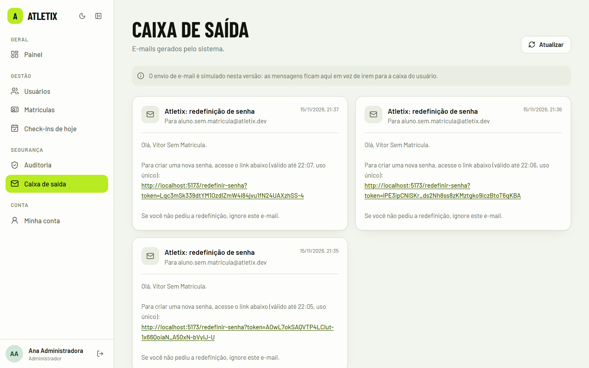

<p class="legenda">Figura 16 — Caixa de saída com o e-mail de recuperação de senha.</p>

O e-mail foi escrito pelo módulo **Notificações** a partir do evento publicado pela **Identidade** (RF05 e RF16). O envio é simulado; trocar por um servidor de e-mail real significa trocar um único adaptador.

### Temas e telas pequenas

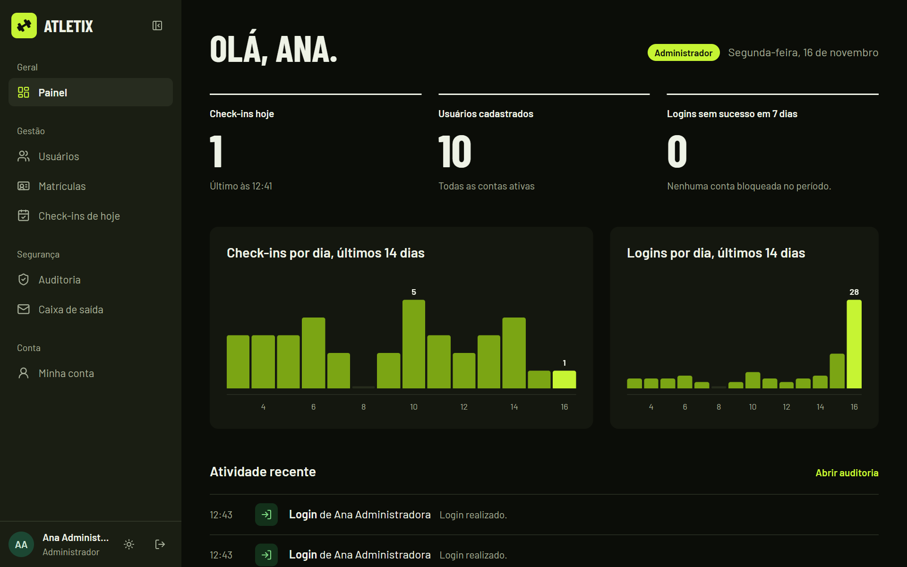

<p class="legenda">Figura 17 — A mesma interface no tema escuro.</p>

<div class="capturas-celular">
  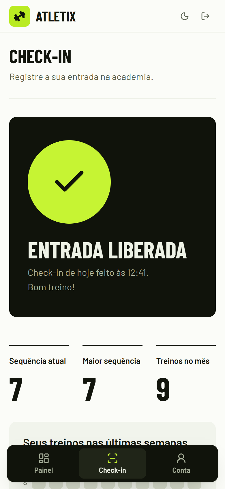
  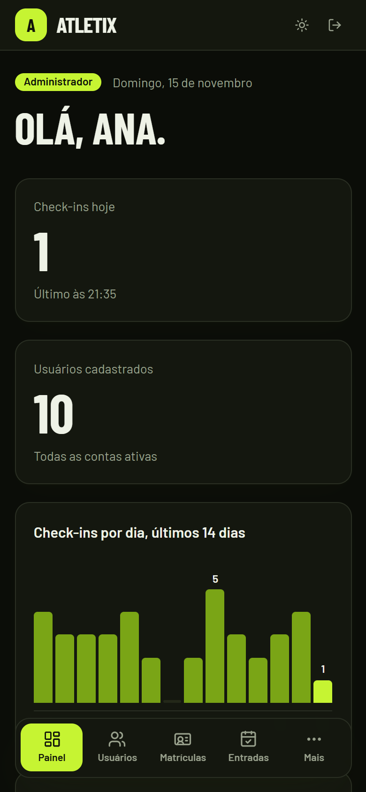
</div>

<p class="legenda">Figura 18 — No celular, o menu lateral vira uma barra inferior. À esquerda, o check-in do aluno; à direita, o painel do administrador no tema escuro.</p>

## 8.3 Autoria

O código da aplicação (a API em NestJS, a interface em React e os testes automatizados) e esta documentação foram desenvolvidos por:

- **Eduardo de Miranda**
- **Eduarda Roberta Borges da Silva**
- **Rebeca Lucio Souza Chagas**

O histórico de alterações está no repositório: https://github.com/dudumiranda3105/Atletix
